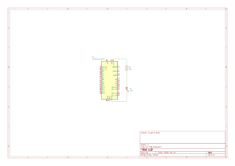
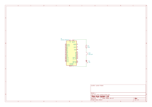
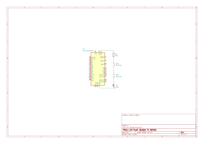
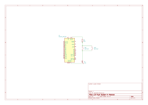

# LED Schematic

Use a 220Ω resistor as the LED is approximately 25 mA.

# Push Button Schematic

Add a push button in between the resistor and the LED to be able to turn the LED on and off with a momentary switch

# Push Buttons in Series Schematic

Series means that the electricity has to go through both switches. In this case, if either only `SW1` is pressed or `SW2` is pressed, the LED won't light. If both `SW1` and `SW2` are pressed, the LED will light up. This is equivalent to a AND in logic.

# Push Buttons in Parallel Schematic

Parallel means that the electricity can choose the path of least resistance, meaning it only has to go through one switch to power the LED. Therefore if either `SW1`, `SW2`, or both are pressed, the LED will light up. This is the equivalent to an OR in logic.

# Ohm's Law

$$V=IR$$

where:

- $V$ is voltage, in volts (V)
- $I$ is current, in amperes (A)
- $R$ is resistance, in ohms (Ω)

This can be used to calculate the voltage, current or resistance needed to power something. For example, in our circuits we are providing 5V to an LED with a 220 Ω resistor, therefore, the current going through that resistor is: $\frac{5\text{V}}{220\Omega} = 0.02\overline{27}\text{A} \approx 23\text{mA}$.
