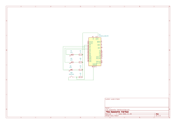

# Spaceship Interface



| Symbol | Description           |
| ------ | --------------------- |
| D1     | Red LED               |
| D2     | Red LED               |
| D3     | Green LED             |
| SW_1   | Momentary Push Button |

## Brief

The brief was to create a spaceship interface with the following features:

- **Button Off:** D3 On, D1 and D2 Off
- **Button On:** D3 Off, D1 and D2 Alternating on and off out of phase

To do this we utilised the microcontroller digital read and write functionality to be able to control the LED's and get the button's state.

## Arduino

Firstly, we used the Arduino code to do the following:

1. Set the pin modes to `INPUT` or `OUTPUT`
2. Read the digital state of the button
3. Set the state for the `HIGH` and `LOW` states of the button

```cpp
// Pin definitions
#define SW_1 2
#define D1 5
#define D2 4
#define D3 3

#define DELAY 75 //ms

void setup() {
  pinMode(SW_1, INPUT);
  pinMode(D3, OUTPUT);
  pinMode(D2, OUTPUT);
  pinMode(D1, OUTPUT);
}

void loop() {
  if(digitalRead(SW_1) == LOW){
    digitalWrite(D3, HIGH);
    digitalWrite(D2, LOW);
    digitalWrite(D1, LOW);
  } else {
    digitalWrite(D3, LOW);
    digitalWrite(D2, HIGH);
    digitalWrite(D1, LOW);

    delay(DELAY);
    digitalWrite(D2, LOW);
    digitalWrite(D1, HIGH);
    delay(DELAY);
  }
}
```

This was good and it worked, but I wanted to go deeper and understand how to write it without the Arduino Library

## C

The way that the bare-metal programming works is that you manipulate registers to set configurations or set IO. In this case, there are 3 registers that we need to use:

1. **DDRD:** This is used for setting whether a pin is `INPUT` or `OUTPUT`.
2. **PORTD:** This is used for setting if an `OUTPUT` is `HIGH` or `LOW` (if the pin is an `INPUT` then it will set whether the pull-up resistor is on or off).
3. **PIND:** This is used to read the digital signal.

So how do we set these registers?

### Bit-masking

Bit-masking is the process of taking two numbers and manipulating multiple bits at the same time while leaving the rest the same as they were before.

For example:

```
     0 0 0 0 0 0 0 0
OR   1 0 1 1 0 0 0 1
---------------------
     1 0 1 1 0 0 0 1
```

#### Constructing Bit-masks Based on Offsets.

So, for example, if we need to set bit position 3 (so `1000` with the position being 0-indexed), we can do the following:

```c
int n = 3;
int x = 1 << n;
```

Where `n` will left shift the 1 that many times.

To chain multiple together, we can use `OR`'s to join them together
For example, to set bits 0, 1, and 3 (1011):

**OR:** If any value is **TRUE**, the output is **TRUE**.

| A   | B   | OUT |
| --- | --- | --- |
| 0   | 0   | 0   |
| 0   | 1   | 1   |
| 1   | 0   | 1   |
| 1   | 1   | 1   |

```c
int x = (1 << 0) | (1 << 1) | (1 << 3);
```

```

     0 0 0 1
OR   0 0 1 0
-------------
     0 0 1 1
OR   1 0 0 0
-------------
     1 0 1 1
```

#### Setting Bits

To set bits (`0` → `1`), we `OR` them together, similar to how we construct the original bit mask, for example, if we want to set bits 0 and 2 without affecting the others, we can do that with:

```c
int x = 0b0010
x |= (1 << 0) | (1 << 2);
// x = 0b111
```

```
     0 0 1 0
OR   0 1 0 1
-------------
     0 1 1 1
```

Bits 0 and 2 are now set without affecting the states of bits 1 and 3.

#### Resetting Bits

To reset a bit (`1` → `0`), we `NOT` the bit-mask and then `AND` it with the original.

**NOT:** The opposite of the input.

| A   | OUT |
| --- | --- |
| 0   | 1   |
| 1   | 0   |

**AND:** If both values are **TRUE** then the output is **TRUE**.

| A   | B   | OUT |
| --- | --- | --- |
| 0   | 0   | 0   |
| 0   | 1   | 0   |
| 1   | 0   | 0   |
| 1   | 1   | 1   |

```c
int x = 0b1010;
x &= ~(1 << 1);
// x = 0b1000
```

```
NOT  1 0 1 0
-------------
     0 1 0 1
AND  0 0 1 0
-------------
     1 0 0 0
```

#### Toggling Bits

To toggle a bit, we can just `XOR` it with a bit mask of the bits you want to toggle. For example if we want to toggle bits 0 and 1, we can do this by:

**XOR:** If ONLY ONE value is **TRUE** then the output is **TRUE**.

| A   | B   | OUT |
| --- | --- | --- |
| 0   | 0   | 0   |
| 0   | 1   | 1   |
| 1   | 0   | 1   |
| 1   | 1   | 0   |

```c
int x = 0b1010;
x ^= (1 << 0) | (1 << 1);
// x = 0b1001
```

```
     1 0 1 0
XOR  0 0 1 1
-------------
     1 0 0 1
```

### `setup` in C

We need to transpile the following Arduino code to C:

```cpp
#define SW_1 2
#define D1 5
#define D2 4
#define D3 3

void setup() {
  pinMode(SW_1, INPUT);
  pinMode(D3, OUTPUT);
  pinMode(D2, OUTPUT);
  pinMode(D1, OUTPUT);
}
```

So we need to set the pin's modes. This is done by manipulating the DDRD register or _"Data Direction Register D"_. `avr/io.h` give's us the pin numbers as constants, which we can then further define for the component symbols.

After this, we then need to set **OUTPUT**'s as `1` and **INPUT**'s as `0` (`0` is the default so we just need to set **OUTPUT**'s).

```c
#include <avr/io.h>

#define SW_1 PD2
#define D1   PD5
#define D2   PD4
#define D3   PD3

int main(void){
  // Set D1, D2, and D3 to OUTPUT
  DDRD |= (1 << D1) | (1 << D2) | (1 << D3);
}
```

### `loop` in C

Then we need the `loop`, to do that in C we just wrap the function we would have written in a `while(1)` loop:

```cpp
void loop() {
  if(digitalRead(SW_1) == LOW){
    digitalWrite(D3, HIGH);
    digitalWrite(D2, LOW);
    digitalWrite(D1, LOW);
  } else {
    digitalWrite(D3, LOW);
    digitalWrite(D2, HIGH);
    digitalWrite(D1, LOW);

    delay(DELAY);
    digitalWrite(D2, LOW);
    digitalWrite(D1, HIGH);
    delay(DELAY);
  }
}
```

So what do we need to do? We need to:

1. Check the state of the button
2. If the button is `LOW` then set `D1` and `D2` **LOW** and set `D3` **HIGH**.
3. If the button is `HIGH` then set `D3` and `D1` **LOW**, set `D2` **HIGH**, wait `DELAY` ms and then toggle `D1` and `D2` and wait `DELAY` ms again.

That third point needs splitting up, but the first thing we can do is check the state of the button. This is done by reading the `SW_1` bit on the PIND register or the _"Port D Input Pins Address"_ which holds the digital state of all pins. We can do this by:

```c
if(PIND & (1 << SW_1))
```

This will check if the bit is `1` or **HIGH** and go down that branch. Then we need to set the state of all of the LED's. Let's start with when the button isn't pressed because that is easier, so `D1` on and everything else off. To do this, we use PORTD or the _"Port D Data Register"_:

```c
// Set D3 HIGH
PORTD |= 1 << D3;
```

Now for the flashing branch, let's set it to it's initial state as well, so `D2` and `D3` **LOW** and `D1` **HIGH**:

```c
// Set D2 and D3 LOW
PORTD &= ~((1 << D2) | (1 << D3));

// Set D1 HIGH
PORTD |= 1 << D1;
```

Then we need a delay, luckily `avr/delay.h` give's us that by calculating how many `noop`'s are needed based on the clock time, which we have to provide as a global definition of `F_CPU`, which on the ATMega328P is `16000000UL` where `UL` is an unsigned long.

This gives us the ability to use the `_delay_ms` syntax. We can't use `DELAY` as a global var because it is used somewhere else so instead we can use `FLASH`

```c
#define F_CPU 16000000UL
#include <avr/io.h>
#include<util/delay.h>

#define FLASH 75 //ms

// ...

_delay_ms(FLASH);
```

Finally, we need to toggle `D1` and `D2`. This can be done with an **XOR** mask:

```c
// Toggle D1 and D2
PORTD ^= (1 << D1) || (1 << D2);
```

Therefore, the whole file looks like:

```c
#define F_CPU 16000000UL
#include <avr/io.h>
#include <util/delay.h>

#define SW_1 PD2
#define D1   PD5
#define D2   PD4
#define D3   PD3

#define FLASH 75 // ms

int main(void){
  // Set D1, D2, and D3 to OUTPUT
  DDRD |= (1 << D1) | (1 << D2) | (1 << D3);

  // Loop
  while(1){
    if(PIND & (1 << SW_1)){
      // Button Pressed
      // Set D3 LOW and alternate D1 and D2 between high and low out of phase
      PORTD &= ~((1 << D2) | (1 << D3));
      PORTD |= 1 << D1;
      _delay_ms(FLASH);
      // Toggle D1 and D2
      PORTD ^= (1 << D1) | (1 << D2);
      _delay_ms(FLASH);
    }else{
      // Button not pressed
      // Set D3 HIGH and PD1 and D2 LOW
      PORTD |= 1 << D3;
      PORTD &= ~((1 << D1) | (1 << D2));
    }
  }
}
```

# Compiling and Flashing

To compile and flash, we have a `Makefile` that does the following:

1. Compile the C file using `avr-gcc` to a `.elf` file
2. Convert the `.elf` file into an ATMEGA328P `hex` file
3. Flash the `.hex` file onto the Arduino

```Makefile
MCU     = atmega328p
F_CPU   = 16000000UL
PORT   ?= $(firstword $(wildcard /dev/cu.usbmodem* /dev/cu.usbserial*))
TARGET  = main

CC      = avr-gcc
OBJCOPY = avr-objcopy
CFLAGS  = -mmcu=$(MCU) -DF_CPU=$(F_CPU) -Os -Wall -Wextra -std=c11

.PHONY: all compile flash clean

all: flash

compile: $(TARGET).hex

$(TARGET).elf: $(TARGET).c
	$(CC) $(CFLAGS) -o $@ $<

$(TARGET).hex: $(TARGET).elf
	$(OBJCOPY) -O ihex -R .eeprom $< $@

flash: $(TARGET).hex
	avrdude -p m328p -c arduino -P $(PORT) -b 115200 -U flash:w:$<:i

clean:
	rm -f $(TARGET).elf $(TARGET).hex
```

Tools used:

| Tool Name     | Description                            | What it's used for                                   |
| ------------- | -------------------------------------- | ---------------------------------------------------- |
| `avr-gcc`     | GNU C Cross-Compiler for AVR MCUs      | Used to compile C code to AVR compliant machine code |
| `avr-objcopy` | GNU Object File Converter for AVR MCUs | Use to convert elf files to hex files                |
| `avrdude`     | MCU Programmer for AVR MCUs            | Used to flash hex onto an AVR board                  |
